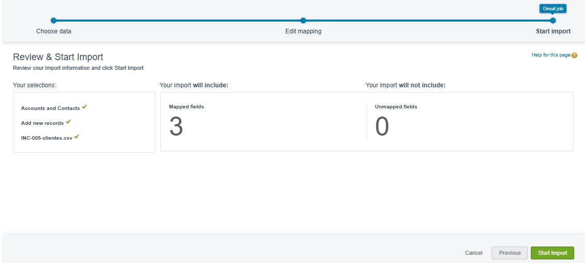
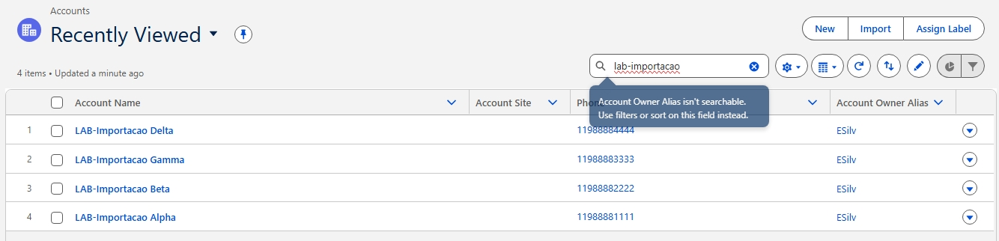
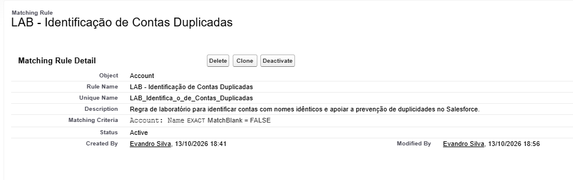
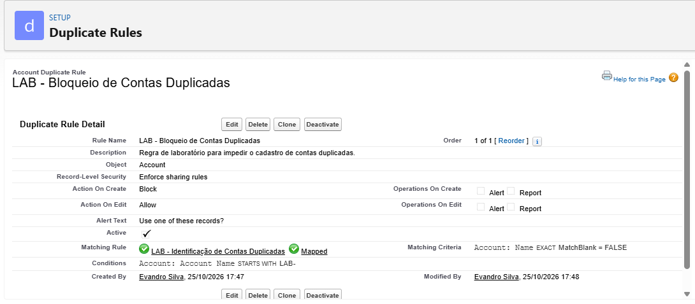
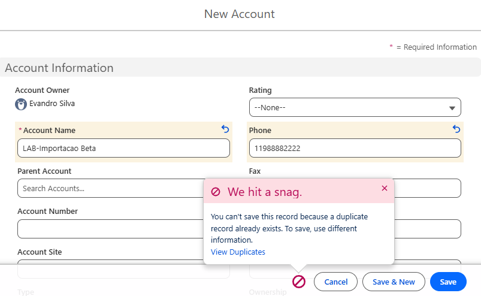

# INC-005 — Importação e Qualidade de Dados

**Plataforma:** Salesforce Sales Cloud  
**Ambiente:** Trailhead Playground  
**Tipo:** Incidente simulado / Melhoria de qualidade de dados  
**Objeto:** Account  
**Status:** Resolvido e validado

## 1. Descrição do cenário

Foi simulada uma solicitação de suporte envolvendo
a importação de uma lista de clientes para o Salesforce.

O arquivo CSV continha cinco linhas de dados, incluindo
duas ocorrências idênticas da conta LAB-Importacao Beta.

O objetivo foi investigar o processamento dos registros,
identificar possíveis duplicidades e implementar um
controle para evitar novos cadastros repetidos.

## 2. Objetivos

- Importar registros utilizando Data Import Wizard.
- Configurar o mapeamento de campos.
- Analisar o resultado da importação.
- Investigar possíveis registros duplicados.
- Criar uma Matching Rule personalizada.
- Configurar uma Duplicate Rule.
- Validar o bloqueio de novos cadastros duplicados.

## 3. Importação de dados

Foi preparado o arquivo INC-005-clientes.csv,
contendo os seguintes campos:

- Name
- Phone
- Website

A importação foi configurada utilizando:

**Ferramenta:** Data Import Wizard  
**Objeto:** Accounts and Contacts  
**Operação selecionada:** Add new records  
**Correspondência:** Name & Site

Os campos do CSV foram mapeados exclusivamente
para os respectivos campos do objeto Account.

### Resultado da importação

O Salesforce apresentou:

- 4 registros processados.
- 4 registros criados com sucesso.
- 0 falhas no lote.
- Status do lote: Completed.

A operação foi registrada como Upsert no
detalhamento do trabalho de importação.

O CSV original continha cinco linhas, mas o
resultado detalhado apresentou quatro registros
criados. Não foi possível determinar, apenas
com essas evidências, o tratamento exato da
quinta linha.

## 4. Investigação dos registros

Após a importação, foi realizada uma consulta
à lista de contas no Salesforce.

Foram identificadas:

- LAB-Importacao Alpha
- LAB-Importacao Beta
- LAB-Importacao Gamma
- LAB-Importacao Delta

A conta LAB-Importacao Beta apareceu uma única
vez na lista consultada.

## 5. Matching Rule

Foi criada uma regra personalizada:

**Nome:** LAB - Identificação de Contas Duplicadas

**Objeto:** Account

**Campo:** Account Name

**Método:** Exact

**Match Blank Fields:** False

**Status:** Active

Essa regra identifica possíveis correspondências
entre contas que possuem nomes idênticos.

## 6. Duplicate Rule

Foi criada uma regra para controlar o cadastro
de contas duplicadas no ambiente de laboratório.

**Nome:** LAB - Bloqueio de Contas Duplicadas

**Objeto:** Account

**Action On Create:** Block

**Action On Edit:** Allow

**Matching Rule utilizada:**
LAB - Identificação de Contas Duplicadas

**Condição de aplicação:**

Account Name starts with LAB-

**Status:** Active

A condição limita a aplicação da regra aos
novos registros cujo nome começa com LAB-.

## 7. Teste funcional

Foi realizada uma tentativa de cadastrar
novamente a conta:

**Account Name:** LAB-Importacao Beta

**Phone:** 11988882222

### Resultado observado

O Salesforce apresentou a mensagem:

"You can't save this record because a duplicate
record already exists. To save, use different
information."

O novo cadastro foi bloqueado, conforme
a configuração da Duplicate Rule.

**Resultado:** teste funcional aprovado.

## 8. Evidências

### Revisão da importação

### Contas importadas

### Matching Rule ativa

### Duplicate Rule ativa

### Bloqueio de cadastro duplicado

## 9. Conclusão

O laboratório permitiu praticar atividades
relacionadas à qualidade de dados e ao suporte
administrativo da plataforma Salesforce.

Foram exercitadas competências de:

- Importação e mapeamento de dados.
- Análise de resultados de processamento.
- Investigação de possíveis duplicidades.
- Configuração de Matching Rules.
- Configuração de Duplicate Rules.
- Validação funcional de regras de bloqueio.
- Registro de evidências técnicas.

A prevenção de duplicidades foi validada
por meio de uma tentativa de cadastro manual
bloqueada pelo Salesforce.

**Natureza do projeto:** exercício educacional
realizado em ambiente Trailhead Playground,
com registros fictícios.
